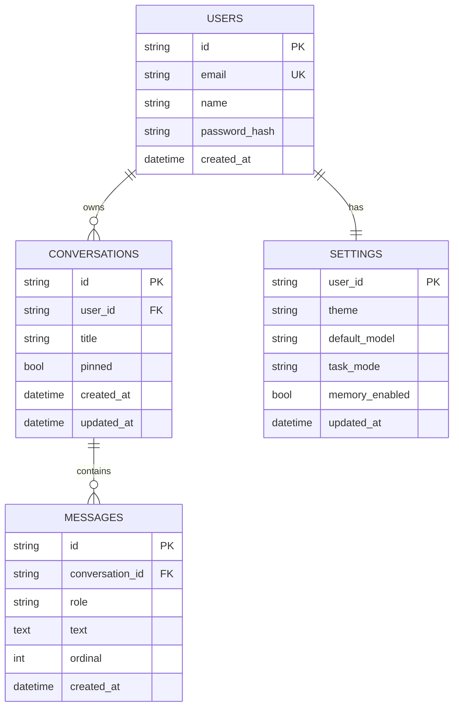
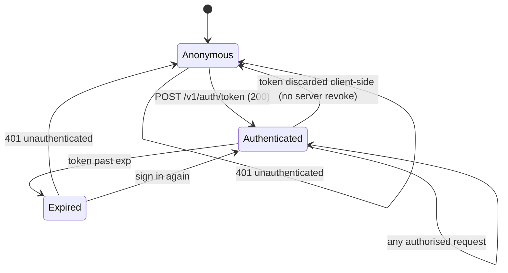
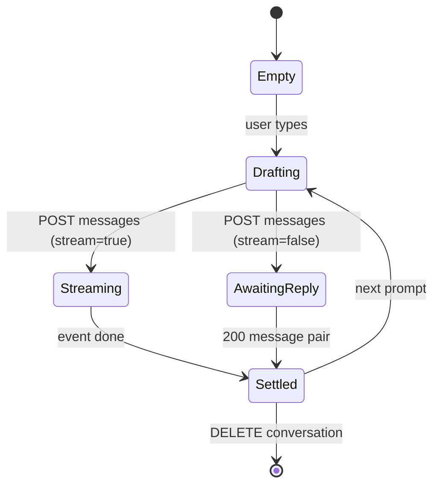
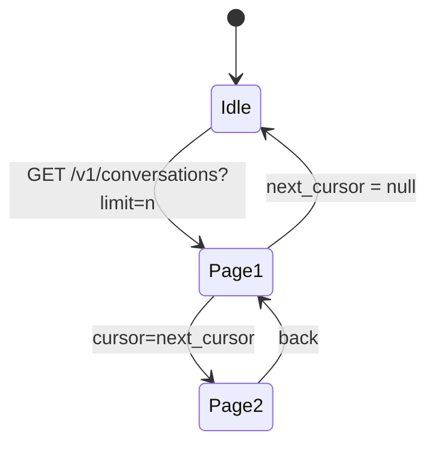

# Architecture — reconstructed backend for the cloned Gemini front end

Provenance rule for this document: no original server response was ever observed
(`recon/00-scope.md` explains why). Endpoints and field names are `INFERRED` from
what the cloned client needs; tables are `INFERRED` from payload shape; anything
the client cannot reveal is `UNKNOWN`.

## 1. Stack

| | |
|---|---|
| Runtime | Python 3.12, FastAPI 0.115, Uvicorn |
| Persistence | SQLAlchemy 2.0 ORM, SQLite locally / PostgreSQL 16 in Compose |
| Auth | own scrypt password hashing + own HMAC-SHA256 signed bearer token |
| Schema creation | `Base.metadata.create_all` via `scripts/migrate.py` (see deviation D1) |
| Streaming | `text/event-stream` from a `StreamingResponse` |

Run locally: `pip install -r backend/requirements.txt`, then
`python -m scripts.migrate` and `uvicorn app.main:app --port 8000`.
Docker: `docker compose up` in `backend/` (Postgres + API, schema and seed on first boot).

## 2. Contract table

Every operation is `INFERRED`: designed from the client's needs, not captured.
Auth column: `bearer` = requires `Authorization: Bearer <token>`.

| Method | Path | Request | Response | Auth | Provenance |
|---|---|---|---|---|---|
| POST | `/v1/auth/register` | `{email, password, name}` | 201 `{access_token, token_type, expires_in, user}` | — | INFERRED |
| POST | `/v1/auth/token` | `{email, password}` | 200 same shape | — | INFERRED |
| GET | `/v1/me` | — | `{id, email, name, created_at}` | bearer | INFERRED |
| GET | `/v1/conversations?limit&cursor` | — | `{items[], next_cursor}` | bearer | INFERRED |
| POST | `/v1/conversations` | `{title?}` | 201 conversation | bearer | INFERRED |
| GET | `/v1/conversations/{id}` | — | conversation + `messages[]` | bearer | INFERRED |
| PATCH | `/v1/conversations/{id}` | `{title?, pinned?}` | conversation | bearer | INFERRED |
| DELETE | `/v1/conversations/{id}` | — | 204 | bearer | INFERRED |
| POST | `/v1/conversations/{id}/messages` | `{text, model?, stream?}` | message pair, or SSE when `stream` | bearer | INFERRED |
| GET | `/v1/search?q&limit` | — | `{query, items[{conversation_id,title,snippet,updated_at}]}` | bearer | INFERRED |
| GET | `/v1/models` | — | `[{id,label,description,locked,thinking_levels[]}]` | — | INFERRED |
| GET | `/v1/suggestions` | — | `[string]` | — | INFERRED |
| GET | `/v1/settings` | — | `{theme, default_model, task_mode, memory_enabled}` | bearer | INFERRED |
| PATCH | `/v1/settings` | any subset of the above | same shape | bearer | INFERRED |
| GET | `/v1/health` | — | `{status, service}` | — | INFERRED |

Error envelope, every failure path: `{"error": {"code": "...", "message": "..."}}`
with codes `unauthenticated` (401), `not_found` (404), `email_taken` (409),
`invalid_request` (422). Messages are this project's wording; only the codes and
the envelope shape are contract.

Pagination is offset-cursor (`next_cursor` is an opaque string), ordered
pinned-first then most recently updated.

## 3. ER model (inferred)

Each column's source: `title` ← the conversation label the sidebar renders;
`pinned` ← the "Pin chat" action in the row menu; `ordinal` ← turn order in the
transcript; `theme/default_model/task_mode/memory_enabled` ← the settings rows and
the composer's model picker. Columns with no client-visible source: none added;
indexes and constraints are our choice.

## 4. State machines (inferred)

Sign-out is client-side only: tokens are stateless, so there is no `/logout`
endpoint. That is a deliberate design choice, not an observed behaviour.

## 5. Server-side logic hypotheses

| # | Hypothesis | Rests on | Test that would falsify it |
|---|---|---|---|
| H1 | A new conversation takes its title from the first user message, truncated | the sidebar shows a title after the first prompt | send a message to an untitled chat and read `title` |
| H2 | Turn order is server-assigned, not client-supplied | client sends only `{text}` | post two messages, assert ordinals 0..3 |
| H3 | Another user's conversation is reported as 404, not 403 | avoids leaking existence; standard practice | cross-account request returns 404 |
| H4 | Deleting a conversation deletes its messages | the client has no separate message-delete call | delete then read → 404, rows gone |
| H5 | Search covers both titles and message bodies | the panel is labelled "Search chats" and matches body text in the reference UI | query a word that appears only in a body |

All five are implemented as described and covered by tests.

## 6. Deliberate assumptions

| # | Assumption | Why |
|---|---|---|
| A1 | Offset pagination instead of opaque keyset cursors | simplest contract that the client can page with; no observed cursor to match |
| A2 | `stream` is a request flag, not a separate endpoint | keeps one route and one storage path |
| A3 | Models/suggestions are static server data | the picker's list is fixed in the UI |
| A4 | No token revocation | stateless tokens; TTL is the only expiry |
| A5 | Reply generation is local and explicitly labelled as mock | there is no model in this project, and inventing one would misrepresent it |

## 7. Unknowns

- How the original derives a conversation title, and whether it is user-editable server-side.
- Whether the original stores per-turn metadata (token counts, attachments, citations) — never visible.
- Attachment and file storage: the upload flow exists in the UI, no endpoint is documented here.
- Server-side task scheduling behind the "Scheduled" surface.
- Any admin, billing or account-deletion surface.
- Real rate limits, quotas and abuse controls.
- The original's error codes, retry semantics and idempotency keys: `UNKNOWN`, so this service defines its own.

## 8. Deviations from the skill's target stack

| # | Deviation | Reason |
|---|---|---|
| D1 | No Alembic; schema via `create_all` plus `scripts/migrate.py` | the schema is small and single-revision; Alembic would add a dependency with no migration history to manage yet. Adding it later is a mechanical change. |
| D2 | SQLite default for local runs | zero-setup dev and tests; Compose uses PostgreSQL 16 as specified |
| D3 | No `x-inferred-routes` section in the spec | no client bundle was ever inspected, so there are no bundle-only routes to list |

## 9. Verbatim strings kept for parity

None. Every user-facing string in this service (error messages, model labels,
suggestion prompts, mock reply text) was written for this repository.
